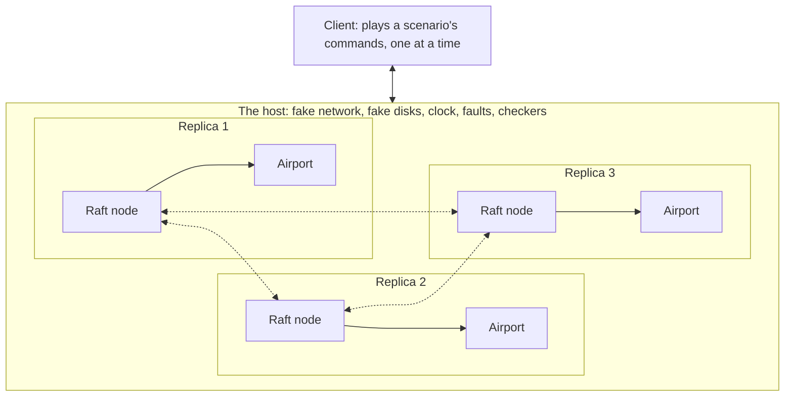
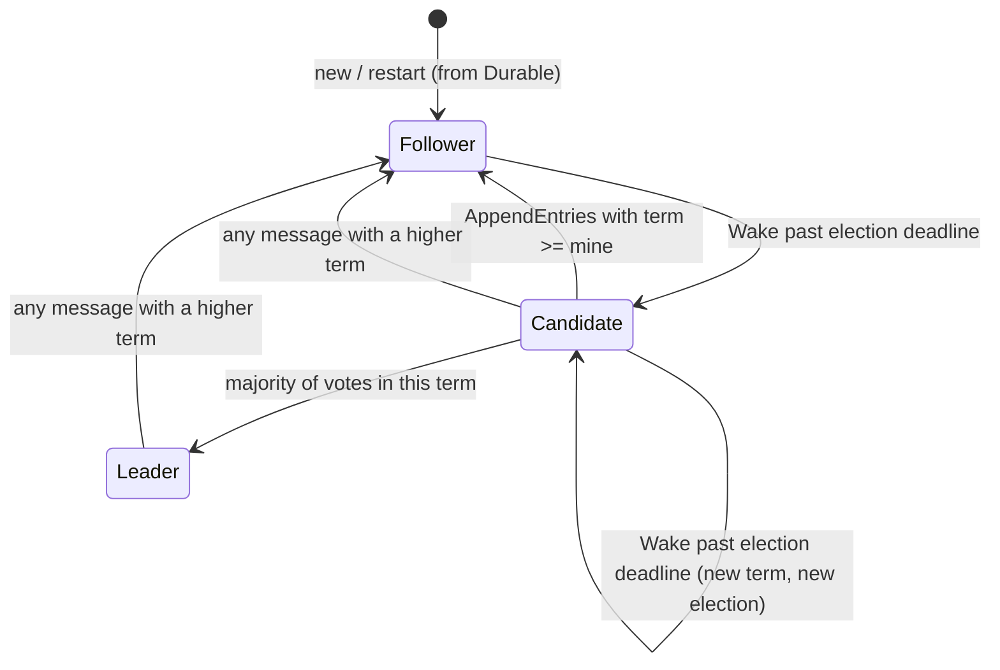

# Phase 2 spec: the host, and three replicas that agree

This is the working document for Phase 2 of Airport Simulator. It has two parts: a short review of the repository as it stands after Phase 1, and a list of tickets for building Phase 2.

A copy is meant to sit at `design/phase-2-spec.md` in the repository, next to the design proposal.

## 1. How to use this document

- **Each ticket stands on its own.** It says what to build, the rules it must obey, and how you know it is finished. You should not need to scroll back to understand one.
- **Each ticket is marked "by hand" or "fine to delegate".** By hand means it is distributed-systems logic and the point of the project. Fine to delegate means plumbing that Claude Code can do without taking any of the learning away.
- **The tickets give rules and tests, not solutions.** Where a ticket lists rules, they are the published rules of Raft, restated in this project's words. How to structure the code that obeys them is left to you.
- **One section is marked as a spoiler.** Ticket E4 names the classic mistakes people make when writing Raft. Skip that list until your implementation passes everything else, if you would rather find them yourself.

## 2. Review of the repository so far

I read every file in the repository at commit `0190ecf`. I could not run the tests, because the pinned Rust 1.97 toolchain could not be downloaded where I was working, so this review is from reading the code, not from running it.

### What is in good shape

- **The airport is already the right shape for replication.** `Airport::apply(&Command) -> Vec<Output>` is the whole interface, and time only moves through `Command::AdvanceTime`. That is exactly what a replicated log needs to feed: one command in, a new state and some outputs out.
- **Determinism is enforced, not just intended.** The Clippy ban list, the hand-written random number generator in `rng.rs`, the fixed-width fingerprint in `fingerprint.rs`, and the web test that runs the same scenario natively and as WebAssembly and demands identical output are all in place.
- **The tests are the right kind.** `tests/rules.rs` shows its arithmetic, and `tests/invariants.rs` uses a checker that shares the data tables with the airport but none of its logic. Phase 2 uses that same idea for Raft.
- **The result does not depend on how often the clock ticks.** There is a test for this. It matters for Phase 2, because it means a delay in replicating a command cannot change what the airport decides, only when the replicas hear about it.
- **Phase 1's finish line in the design proposal is met**, as far as reading can tell: same fingerprint in both builds, hand-worked rates for a flooded runway, and tests for all four modelled aspects of aviation.

### Six things Phase 2 has to deal with

These are not faults in Phase 1. They are the places where the existing code meets the new work.

1. **The random number generator and the fingerprint live in the `airport` crate.** The Raft crate needs random numbers (for election timing) and the host needs both, but Raft should not have to depend on airports. Ticket A1 moves them to a small shared crate.
2. **Commands carry no sender and no sequence number.** A resent command would be applied twice. The airport half-defends itself today: a second `RequestLanding` for the same flight is answered with `Rejected: DuplicateFlight`. But that still changes the state (the rejected count goes up, so the fingerprint changes) and gives the sender the wrong answer. Ticket D2 fixes this outside the airport, as the design proposal says.
3. **`Airport` can be cloned but not saved.** Only the display `Snapshot` can be turned into JSON. That rules out one Raft feature, throwing away old log entries once a saved copy of the state exists. Phase 2 does without it: a restarted replica rebuilds its airport by re-applying its log from the start. Section 5 lists this as out of scope.
4. **The existing scenario format is a gift.** `Scenario.commands` is a flat, ordered list that already includes every `AdvanceTime`. It can be used unchanged as the script a client sends to the replicas, and `scenario::run` gives the exact outputs and final fingerprint a correct replicated run must also produce. Ticket E2 builds on this.
5. **The `host` crate is currently a pass-through.** It turns a scenario into a result with no replicas involved. Keep `run_scenario` exactly as it is: it becomes the reference answer.
6. **The `raft` crate is empty apart from a comment**, so nothing needs undoing.

## 3. Phase 2 on one page

**The goal.** Three copies of one airport, running inside the host, that stay identical while the network loses messages and copies crash.

**The words used in this document.** Several of these are new since the design proposal.

| Word | Meaning |
|---|---|
| **Node** | One participant in Raft. It holds a log and takes part in elections. It knows nothing about airports. |
| **Replica** | A node plus an airport plus the bookkeeping that joins them. Three replicas make the airport group. |
| **Log** | A node's numbered list of entries. Positions start at 1. |
| **Entry** | One item in a log: a command, plus the election term in which a leader first stored it. |
| **Election term** | A counter that goes up every time any node starts an election. Raft calls this a "term". Every message carries one. |
| **Leader, follower, candidate** | The three roles a node can be in. At most one leader per election term. |
| **Majority** | More than half of the nodes. With three nodes, two. |
| **Committed** | An entry is committed once it is guaranteed never to be lost or replaced. Only committed entries are applied to the airport. |
| **Client** | Anything that sends commands to the airport group and waits for replies. |
| **Host** | The one real program. It runs the nodes and the client, and plays the network, the disks and the clock. |
| **Checker** | Code in the host that inspects everything after every step and fails the run if a rule is broken. |
| **Seed** | The one number that all randomness in a run comes from. Same seed, same run. |

**The picture.**



**What gets built, in five pieces.**

| Piece | Lives in | What it is |
|---|---|---|
| A. Groundwork | new shared crate | Moves shared tools out of `airport`, defines identifier types. |
| B. Raft | `crates/raft` | Elections, log copying, commitment. Pure logic. |
| C. The host | `crates/host` | Event loop, fake network, fake disk, fault injection, trace. |
| D. Replica and client | `crates/host` | Joins Raft to the airport, filters duplicates, and the client that sends commands. |
| E. Checkers | `crates/host` | The rules that must never break, and proof that the checkers work. |

Pieces F (bulk runs and tooling) and G (the web view) are plumbing. Piece H is optional extras.

## 4. Decisions already made in this spec

Each of these could have gone another way. They are fixed here so the tickets fit together. Change any of them if you disagree, but change it before starting.

| Decision | Choice | Why |
|---|---|---|
| How Raft learns the time | Every input to a node carries the current simulated time. The node says when it next needs waking. | The host is an event loop, so "wake me at time T" costs one event. A regular tick would cost events when nothing is happening. |
| How Raft gets randomness | Each node is given its own seeded generator when it is created. | Keeps the node pure, and the host stays in charge of the seed. |
| How the fake disk works | A node keeps everything that must survive a crash in one struct. On a crash the host keeps that struct and throws the rest of the node away. | It makes "what survives a crash" impossible to get wrong by accident, and costs nothing at run time. Disks that fail come in Phase 5. |
| What Raft stores | Raft is generic over the command type. It never looks inside a command. | Keeps `raft` free of airports, and lets the same code replicate controllers in Phase 5. |
| Where duplicates are filtered | In the replica, when an entry is applied. Not in Raft, not in the airport. | As the design proposal says. It is the only point where all three replicas are guaranteed to make the same decision. |
| Airport time and host time | Separate in Phase 2. Airport time is just a number inside `AdvanceTime` commands. Host time drives message delays and election timers. | A six-hour scenario can be replicated in a few simulated minutes. Tying the two clocks together is the controller's job in Phase 3. |
| How many clients | One, playing a scenario in order with one command outstanding at a time. | With one client, the agreed log must equal the scenario, which gives an exact reference answer. |
| Cluster size | Three, but nothing in `raft` may assume three. | Tests should also run with one node and five. |

## 5. Out of scope for Phase 2

- **Discarding old log entries.** Logs grow for the whole run. (Raft calls the feature that fixes this "log compaction" or "snapshots".)
- **Changing which nodes are in the group** while it runs.
- **Disks that lose or corrupt data.** The fake disk is perfect. Phase 5.
- **Reading the airport's state through Raft.** Clients only send commands. The web view looks at replicas directly through the host.
- **Tying airport time to host time**, the speed dial, and injecting events from a person. Phase 3.
- **Performance work** such as sending several entries per message as a tuned batch, or sending the next message before the previous one is acknowledged. Do the simplest correct thing.

## 6. Suggested order

The pieces are grouped by subject in section 7, but that is not the best order to build them in. This order gets something visibly running early and adds one hard idea at a time.

1. **A1, A2.** Groundwork.
2. **B1, C1, C2.** An empty node, the event loop, and a perfect network. Three nodes that exchange nothing yet.
3. **B2, C6, E1 (the first rule only).** Elections. You can now watch a leader get elected in the trace, and a checker confirms there is never more than one.
4. **B3, B4, B5.** Logs are copied, repaired and committed.
5. **D1, D3.** An airport behind each node, and a client playing a scenario. On a perfect network the final fingerprint should match Phase 1.
6. **E1 (the rest), E2.** The full set of checkers. Everything should pass on a perfect network.
7. **C3, B6.** Crashes and restarts.
8. **C4, C5.** Lost, late and repeated messages, split networks, and a seeded schedule of faults. This is where the bugs appear.
9. **D2.** Duplicate filtering. The checkers from step 6 will already be failing without it.
10. **E3, E4.** Progress after faults clear, and proof that the checkers can catch real mistakes.
11. **F1 to F3, G1 to G2.** Bulk runs, automation and the web view.

## 7. Tickets

### A. Groundwork

#### A1. Move the shared tools into their own crate
*Fine to delegate · Needs: nothing · Small*

**Build.** A new crate (suggested name `det`, for "deterministic") holding `Rng` and the fingerprint code, both moved unchanged from `airport`. `airport` re-exports them so nothing else has to change.

**Done when.** All existing tests pass untouched, including the web test that compares the native and WebAssembly builds, and `raft` can use `Rng` without depending on `airport`.

#### A2. Identifier types
*Fine to delegate · Needs: nothing · Small*

**Build.** Small wrapper types so that different kinds of number cannot be mixed up: a node identifier, a client identifier, an election term, and a log position. All fixed-width, none `usize`, all deriving `Hash`, `Ord` and the serde traits.

**Done when.** They exist and it is a compile error to pass a log position where an election term is expected.

### B. Raft

Everything in this piece lives in `crates/raft`, is pure logic, and is tested without the host by a few lines of test code that hand messages from one node to another.

One principle applies to every ticket here. **The network may deliver any message late, twice, out of order, or not at all.** Every handler must do the right thing in all four cases. A reply is just another message: there is no guarantee it arrives, and no guarantee it is the reply to the thing you sent most recently.

#### B1. The node's skeleton
*By hand · Needs: A1, A2 · Small*

**Build.** The node type and its interface, with no behaviour yet. A suggested shape, signatures only:

```rust
pub enum Payload<C> { Noop, Command(C) }
pub struct Entry<C> { pub term: Term, pub payload: Payload<C> }

/// Everything that survives a crash. Nothing else does.
pub struct Durable<C> {
    pub term: Term,
    pub voted_for: Option<NodeId>,
    pub log: Vec<Entry<C>>,
}

pub enum Input<C> {
    Wake,                                        // a time you asked to be woken at has passed
    Message { from: NodeId, message: Message<C> },
    Propose(C),                                  // a client wants this command stored
}

pub enum Effect<C> {
    Send { to: NodeId, message: Message<C> },
    Committed { index: Index, entry: Entry<C> }, // in order, each position once per life of the node
    NotLeader { hint: Option<NodeId> },          // answer to a Propose this node cannot accept
}

impl<C: Clone + Eq> Node<C> {
    pub fn new(id: NodeId, peers: Vec<NodeId>, config: Config, durable: Durable<C>, rng: Rng, now: Ms) -> Self;
    pub fn step(&mut self, now: Ms, input: Input<C>) -> Vec<Effect<C>>;
    pub fn next_wake(&self) -> Option<Ms>;       // when the host should send the next Wake
    pub fn into_durable(self) -> Durable<C>;     // what is left after a crash
    pub fn status(&self) -> Status;              // role, term, positions: for checkers and the web view
    pub fn log(&self) -> &[Entry<C>];            // read-only, for checkers
}
```

**Rules.**
- A node starts as a follower in whatever election term its `Durable` says, which is 0 for a brand new node.
- Inside the node, split state clearly into what is in `Durable` and what is not. Role, the commit position, the list of who voted, and what a leader knows about its followers are all lost on a crash.
- A `Wake` that arrives early or late must be harmless. The node checks the time itself.

**Done when.** A node can be created, stepped with any input without panicking, and turned back into its `Durable`.

#### B2. Elections
*By hand · Needs: B1 · Medium*

**Build.** The two election messages (a request for a vote, and the reply) and the role changes between follower, candidate and leader.

**Rules.**
- **Timing.** A follower or candidate that goes a full election timeout without hearing from a leader or granting a vote starts an election. The timeout is chosen at random each time it is reset, between one and two times a base value from `Config`.
- **Starting an election.** Add one to the election term, vote for yourself, and ask every other node for its vote. The request states your term and the term and position of the last entry in your log.
- **Higher term seen.** Any message, of any kind, carrying a higher election term than your own makes you adopt that term, forget who you voted for, and become a follower, before you handle the message.
- **Lower term seen.** A request carrying a lower election term than your own is refused, and the refusal states your term.
- **Granting a vote.** Grant it only if you have not already voted for someone else in this election term, and the candidate's log is at least as up to date as yours. "Up to date" compares the term of the last entry first, and the length of the log second.
- **Winning.** A candidate that holds votes from a majority, counting its own, becomes leader for that election term and immediately tells everyone.
- **Losing.** A candidate that hears from a leader whose term is at least its own becomes a follower.

**Tests.**
- Three nodes, messages handed over by hand: one times out, the other two vote, it becomes leader.
- Two candidates in the same term: at most one wins.
- A node that has voted refuses a second candidate in the same term, and grants the same candidate again if asked twice.
- A candidate with a shorter log is refused by a node with a longer one.
- A cluster of one elects itself.
- A vote reply from an earlier election term changes nothing.

#### B3. Copying the log
*By hand · Needs: B2 · Medium*

**Build.** The message a leader uses to send entries to a follower, its reply, and `Propose`.

**Rules.**
- **Heartbeat.** A leader sends every follower a message at a regular interval from `Config`, whether or not there is anything new to send. This is what stops followers starting elections.
- **Proposing.** A leader given a `Propose` adds the command to the end of its own log, stamped with its election term. Any other node answers `NotLeader`, with the leader it last heard from if it knows one.
- **What the message says.** The leader's term; the position and term of the entry just before the ones being sent; the entries; and the leader's commit position.
- **The consistency check.** A follower accepts the message only if its own log has an entry at that "just before" position with that same term. Otherwise it refuses.
- **What the leader tracks.** For each follower: the next position to send, and the highest position it knows that follower holds.

**Tests.**
- A proposal to the leader appears in all three logs after the messages are handed over.
- A proposal to a follower returns `NotLeader` with the right hint.
- With no proposals, followers never time out while heartbeats are delivered.
- Entries sent to a follower with an empty log are accepted from position 1.

#### B4. Repairing a log that has diverged
*By hand · Needs: B3 · Medium*

**Build.** What happens when a follower's log does not match the leader's.

**Rules.**
- **On refusal**, the leader steps back and tries again from an earlier position, until it finds a point where the two logs agree.
- **On acceptance**, if the follower already has an entry at a position being sent but with a different term, that entry and everything after it in the follower's log is deleted, and the leader's entries take their place.
- **A leader never deletes or overwrites anything in its own log.**

**Tests.** Build these situations by hand by constructing each node's `Durable` directly.
- A follower missing the last few entries catches up.
- A follower with extra entries from an old leader that were never committed has them removed and replaced.
- A follower whose log is entirely different after position 3 is repaired from position 4.
- The six follower logs in Figure 7 of the Raft paper all end up identical to the leader's.

#### B5. Commitment, and handing entries over to be applied
*By hand · Needs: B4 · Medium*

**Build.** The rule for when an entry is safe forever, and the `Committed` effect.

**Rules.**
- **Leader.** A position is committed once a majority of nodes, counting the leader, hold the entry at that position, **and** that entry is from the leader's own current election term. Everything before a committed position is committed too.
- **A new leader's first act** is to add an empty entry (`Payload::Noop`) from its own term to its log. Without this, entries left over from earlier terms could sit uncommitted forever when no new commands are arriving.
- **Follower.** A follower learns the commit position from the leader's messages. It never moves its own commit position past the last entry that the message it just accepted vouches for.
- **Handing over.** Each time the commit position moves forward, the node emits one `Committed` effect per newly committed position, in order, with no gaps and no repeats.
- **The commit position never moves backwards.**

**Tests.**
- An entry held by two of three nodes is committed; an entry held only by the leader is not.
- A leader isolated from both followers accepts proposals but commits none of them.
- The situation in Figure 8 of the Raft paper: an entry from an old term that is on a majority of nodes is not committed until an entry from the current term is.
- After a new leader is elected with no new proposals, leftover entries become committed because of the empty entry.

#### B6. Surviving a crash
*By hand · Needs: B5 · Small*

**Build.** Nothing new, if B1's split was done properly. This ticket is the check that it was.

**Rules.**
- A node rebuilt from its `Durable` is a follower, with a commit position of 0, that remembers its election term, who it voted for in that term, and its whole log.
- Because the commit position restarts at 0, a restarted node emits `Committed` for every position again, from 1, as it relearns the commit position from the leader.

**Tests.**
- A node that voted, crashed and restarted refuses to vote for a different candidate in the same term.
- A leader that crashes and restarts does not believe it is still leader.
- A restarted follower re-emits `Committed` for positions 1 onwards, in order.

### C. The host

Everything in this piece lives in `crates/host`. The host is generic plumbing in one sense, but its fault injection is half of what makes the project "like TigerBeetle", so most of it is marked by hand.

#### C1. The event loop and the clock
*By hand · Needs: A1 · Small*

**Build.** The to-do list at the centre of the host: events ordered by simulated time, and a loop that takes the earliest, moves the clock to it, and handles it.

**Rules.**
- Two events at the same simulated time are handled in the order they were added. This must be explicit, not an accident of the data structure.
- Simulated time never goes backwards.
- All randomness comes from generators derived from one seed. Use a separate generator for each purpose (network, faults, each node), each derived from the seed, so that changing the fault settings does not change the message delays.

**Done when.** A test schedules events out of order and sees them handled in time order, with ties in insertion order, and the same seed gives the same sequence twice.

#### C2. A perfect network, and three nodes on it
*By hand · Needs: C1, B1 · Small*

**Build.** The host creates three nodes. When a node emits `Send`, the host schedules a delivery event a fixed short time later. When a node's `next_wake` changes, the host schedules a `Wake`.

**Rules.**
- Nodes never hold references to each other or to the host. Messages are values that move through the event list.
- A `Wake` scheduled for a time the node no longer cares about is delivered anyway and ignored by the node.

**Done when.** With B2 in place, three nodes on the perfect network elect exactly one leader and keep it.

#### C3. The fake disk, crashes and restarts
*By hand · Needs: C2, B6 · Small*

**Build.** Two host operations. Crash: take the node's `Durable`, keep it, and discard the node. Restart: build a new node from the kept `Durable`, with a new generator derived from the seed.

**Rules.**
- Messages addressed to a crashed node are dropped when they would have been delivered.
- A `Wake` for a crashed node is dropped. One left over from before the crash that fires after a restart is harmless.
- Whatever sits on top of the node (the airport, in ticket D1) is discarded on a crash too.

**Done when.** Crashing the leader on the perfect network produces a new leader within a few election timeouts, and restarting the old one brings it back as a follower with a matching log.

#### C4. An unreliable network
*By hand · Needs: C2 · Medium*

**Build.** Replace the perfect network's fixed delay with seeded misbehaviour, controlled by settings:

| Fault | Behaviour |
|---|---|
| Delay | Each message is delivered after a random time between a minimum and a maximum. Messages overtaking each other falls out of this for free. |
| Loss | Each message is dropped with a given probability. |
| Duplication | Each message is delivered a second time, after a different delay, with a given probability. |
| Partition | A set of blocked links. A message whose link is blocked at the moment of delivery is dropped. Links are one-directional, so "A can reach B but B cannot reach A" is possible. |

**Done when.** Unit tests show each fault doing what the table says, and the same seed produces the same pattern of faults twice.

#### C5. A seeded schedule of faults
*By hand · Needs: C3, C4 · Medium*

**Build.** A generator that turns a seed and a difficulty level into a list of timed fault events: crash this node, restart it, block these links, unblock them. The host adds them to its event list at the start of a run.

**Rules.**
- Three levels, in the spirit of the TigerBeetle demo:

| Level | Network | Faults |
|---|---|---|
| Calm | Short delays, nothing lost. | None. |
| Rough | Longer delays, some loss and duplication. | One node at a time crashed or cut off, so a majority can always talk. |
| Hostile | Delays longer than the election timeout, heavy loss and duplication. | Anything, including a majority down at once, one-directional partitions, and faults in quick succession. |

- Every schedule ends with a **heal**: all nodes restarted, all links unblocked, network set to calm. The run then continues for a fixed stretch of simulated time. Ticket E3 depends on this.
- At the hostile level the group will often make no progress for long periods. That is expected. Only safety is being tested there until the heal.

**Done when.** A seed and a level always produce the same schedule, and a run at each level reaches its heal.

#### C6. The trace
*Fine to delegate · Needs: C2 · Small*

**Build.** A list of everything the host did, in order, as a serde-serialisable enum: message sent, delivered, dropped or duplicated; role or election term changed; position committed; entry applied with the fingerprint afterwards; node crashed or restarted; links blocked or unblocked; client sent or received something.

**Rules.**
- Recording the trace must not change the run. A run with the trace switched off has the same fingerprints as one with it on.

**Done when.** A run can print its trace as readable lines, and as JSON for the web view in piece G.

### D. Replica and client

#### D1. The replica
*By hand · Needs: B5, C2 · Medium*

**Build.** A type that owns one Raft node and one `Airport`. It passes inputs to the node, and for every `Committed` effect it applies the entry to the airport.

**Rules.**
- The airport is only ever changed by applying committed entries, in order.
- An empty entry (`Payload::Noop`) is skipped.
- After applying each entry the replica records the position and the airport's fingerprint, and puts both in the trace.
- A restarted replica starts with a fresh `Airport::new` and rebuilds it as its node re-emits `Committed` from position 1.
- The replica answers the client only if its node is the leader at the moment the entry is applied.

**Done when.** On the perfect network with commands proposed straight to the leader, all three replicas report the same fingerprint at every position.

#### D2. Filtering duplicate commands
*By hand · Needs: D1, D3 · Medium*

**Build.** The wrapper that travels through Raft, and the table that filters repeats.

```rust
pub struct Request { pub client: ClientId, pub seq: u64, pub command: Command }

pub enum ClientReply {
    Done { seq: u64, outputs: Vec<Output> },
    NotLeader { hint: Option<NodeId> },
}
```

**Rules.**
- Raft replicates `Request` values. The airport still only ever sees the `Command` inside.
- Each replica keeps a table with one row per client: the highest `seq` applied for that client, and the outputs that application produced.
- When a committed `Request` is about to be applied:
  - If its `seq` is one more than the client's row, apply it, and store the outputs in the row.
  - If its `seq` equals the client's row, do **not** apply it. If this replica is the leader, send the stored outputs again.
  - If its `seq` is lower than the client's row, ignore it.
  - A `seq` more than one above the row cannot happen with a correct client. Treat it as a bug and fail loudly.
- The table is changed only by applying committed entries, so it is identical on all replicas at the same position. Include it in the replica's fingerprint.
- The table is lost in a crash and rebuilt along with the airport.

**Tests.**
- The same `Request` committed at two positions changes the airport once, and the second produces the same reply as the first.
- A retried `RequestLanding` does not produce `Rejected: DuplicateFlight` and does not change the rejected count.
- Two replicas given the same log, including repeats, have the same table and the same fingerprint.

#### D3. The client
*By hand · Needs: D1 · Medium*

**Build.** A participant in the host that plays the commands of a `Scenario` in order and collects the replies.

**Rules.**
- The client has at most one command outstanding. It does not send command *n+1* until it has a `Done` reply for command *n*.
- Each new command gets the next `seq`. A resend uses the same `seq`.
- The client sends to the node it believes is leader. On `NotLeader` it follows the hint if there is one, and otherwise tries another node.
- If no reply arrives within a timeout, it resends, to a different node.
- A reply whose `seq` is not the one outstanding is ignored.
- The client's messages travel over the same fake network as everything else, so they can be lost, delayed and duplicated too.
- The client itself does not crash in Phase 2.

**Done when.** On the perfect network, the client plays a whole demo scenario and the outputs it collected, in order, equal `scenario::run`'s outputs for the same scenario.

### E. Checkers

The checkers run inside the host after every event. They can see inside every node through `status()` and `log()`. A failure stops the run and reports the seed, the simulated time, and which rule broke.

Write the checkers with the same discipline as `tests/invariants.rs` in the airport crate: they may share types with the code they check, but none of its logic.

#### E1. Raft's safety rules
*By hand · Needs: B5, C2 · Medium*

**Build.** One checker per rule. The first five are the five guarantees stated in the Raft paper.

| Rule | What must hold |
|---|---|
| One leader per term | No two nodes are ever leader in the same election term. This holds across the whole run, not just at one instant. |
| Leaders only append | While a node is leader, it never removes or changes an entry in its own log. |
| Logs match | If two nodes' logs have an entry with the same term at the same position, their logs are identical from position 1 up to that position. |
| Leaders are complete | Once an entry is committed, every node that becomes leader in a later term has it in its log. |
| Same entry at each position | No two nodes ever emit `Committed` for the same position with different entries. |
| Terms only rise | A node's election term never decreases, including across a crash and restart. |
| One vote per term | A node's recorded vote never changes within an election term, including across a crash and restart. |
| Commit only rises | Within one life of a node, its commit position never decreases, and a committed entry is never removed from any log. |

**How.** Several of these need the checker to remember things for the whole run: who has been leader in each term, and what has been committed at each position.

**Done when.** A long calm run passes all eight, and each has a unit test that feeds the checker a deliberately broken state and sees it fail.

#### E2. The airport's rules, end to end
*By hand · Needs: D1, D3, E1 · Medium*

**Build.** Three checkers above the Raft level.

| Rule | What must hold |
|---|---|
| Replicas agree | Any two replicas that have applied the same position report the same fingerprint at it. |
| Exactly once | For each client and `seq`, each replica changes its airport at most once per life, however many times the request appears in the log. |
| Same answer as one airport | At the end of the run, every live replica's airport fingerprint, and the client's collected outputs in order, equal what `scenario::run` gives for the same scenario with no replication at all. |

**Why the third rule is so strong.** With one client sending one command at a time, the agreed log has to contain the scenario's commands in the scenario's order. So a correct replicated run, however badly the network behaved, must end in exactly the state Phase 1 computes. And since Phase 1's own tests show that state obeys the aviation rules, there is no need to re-check separation or closures here.

**Done when.** All three pass on a calm run, and the third is the final line of every run's report.

#### E3. Progress once the faults stop
*By hand · Needs: C5, D3 · Small*

**Build.** A check at the end of every run, after the heal at the end of the fault schedule.

**Rules.** Within a fixed stretch of simulated time after the heal:
- there is a leader;
- the client has received a reply for every command in the scenario;
- all three replicas have applied the same last position.

**Done when.** A run that would otherwise sit forever with no leader is reported as a failure with its seed, not left to hang.

#### E4. Proof that the checkers can catch mistakes
*By hand · Needs: everything above · Medium*

**Build.** A set of switches, compiled only for tests, each of which breaks the implementation in one specific way. For each switch, a test runs seeds until a checker fails, and fails itself if none does within a fixed number of seeds.

**Why.** A simulator that has never caught a bug has not been shown to work. This is the only way to know that "ten thousand seeds passed" means something.

> **Spoiler.** The list below names well-known mistakes in Raft implementations. If you want to find them yourself, do not read it until your own implementation passes E1 to E3 at the hostile level.

| Switch | The mistake |
|---|---|
| 1 | Grant a vote without comparing logs. |
| 2 | Forget who you voted for when restarting. |
| 3 | Forget the election term when restarting. |
| 4 | Commit an entry from an earlier term as soon as a majority holds it. |
| 5 | On accepting entries, always cut the log off after the last one sent, even when nothing conflicted. |
| 6 | As a follower, set the commit position to whatever the leader says, even beyond what the accepted message covered. |
| 7 | Count two copies of the same vote reply as two votes. |
| 8 | Let a reply from an earlier election term update what the leader believes a follower holds. |
| 9 | Skip the duplicate table and apply every committed request. |
| 10 | As a client, give a resend a new `seq`. |

**Done when.** Every switch is caught, and the test output names which checker caught it and at which seed. Any switch that is never caught means a checker or the fault schedule is too weak, and that is the thing to fix.

### F. Bulk runs and tooling

#### F1. Running many seeds from the command line
*Fine to delegate · Needs: C5, E3 · Small*

**Build.** A new `airport-sim` subcommand that runs a range of seeds at a chosen fault level against a short scenario, stops at the first failure, and prints the seed, the rule that broke, and the exact command to replay it with the trace on.

**Done when.** `just` has a recipe for a quick run (a few hundred seeds) and an overnight run (as many as fit), and a deliberately broken build is reported with a seed that replays to the same failure.

#### F2. Run it twice
*Fine to delegate · Needs: F1, C6 · Small*

**Build.** A test that runs the same seed twice natively and once as WebAssembly, and compares the three traces entry by entry. This extends the existing comparison in `web/src/sim.test.ts`.

**Done when.** It passes for several seeds at each fault level.

#### F3. Automation
*Fine to delegate · Needs: F1, F2 · Small*

**Build.** The automatic checks on every commit run a few hundred seeds at each level, plus the E4 tests.

**Done when.** A commit that breaks agreement fails the automatic checks with a seed in the output.

### G. The web view

#### G1. Expose a replicated run to the browser
*Fine to delegate · Needs: C6 · Small*

**Build.** A function in the `wasm` crate that takes a seed and a fault level and returns the trace as JSON, alongside the existing `runScenario`.

#### G2. The replica view
*Fine to delegate · Needs: G1 · Medium*

**Build.** A second page beside the runway timeline. Three boxes, one per replica, showing role, election term, last log position, commit position and state fingerprint. Messages drawn moving between them. Crashed replicas greyed out, blocked links shown cut. A seed box, a fault level selector, and play, pause and step controls that walk through the trace.

**Done when.** Typing in a seed printed by an overnight failure shows that failure happening.

### H. Optional extras

All by hand. None is needed to finish Phase 2. Each is a self-contained thing to learn.

| Ticket | What | Why it is interesting |
|---|---|---|
| H1 | Faster log repair: on a refusal, the follower says enough for the leader to skip back a whole term at once. | Section 5.3 of the Raft paper sketches it. Matters when logs are long. |
| H2 | A trial election before the real one, so a node that was cut off cannot disrupt a healthy leader when it returns. | Known as "pre-vote". The hostile level will show you the problem it solves. |
| H3 | A leader that steps down if it cannot reach a majority for a while. | Stops a cut-off leader accepting proposals it can never commit. |
| H4 | Discarding old log entries, with a saved copy of the airport and the duplicate table. | Needs `Airport` to be saveable, and a new message for followers that are too far behind. The largest of these. |
| H5 | A second client sending its own commands at the same time. | Exercises one table row per client. The "same answer as one airport" rule has to be restated: replay the agreed log through a fresh airport and compare. |

## 8. Finished when

Phase 2 is finished when all of these are true.

1. Every ticket in pieces A to F is done.
2. An overnight run at the hostile level completes with no checker failing.
3. Every switch in ticket E4 is caught.
4. The same seed gives the same trace natively, twice, and as WebAssembly.
5. A failing seed, produced on purpose with an E4 switch, can be typed into the web view and watched.

## 9. Reading

- [In Search of an Understandable Consensus Algorithm (the Raft paper, extended version)](https://raft.github.io/raft.pdf). Figure 2 is the one-page summary that tickets B2 to B5 restate. Figures 7 and 8 are used as tests in B4 and B5.
- [Diego Ongaro's dissertation](https://github.com/ongardie/dissertation). Chapter 6 covers clients and duplicate filtering, which is ticket D2.
- [Students' Guide to Raft](https://thesquareplanet.com/blog/students-guide-to-raft/). A catalogue of the mistakes students make. It is a spoiler in the same way as ticket E4.
- [tikv/raft-rs](https://github.com/tikv/raft-rs). Not used in this project, but written in the same "pure logic, no clock or network" shape, so useful to read when stuck on structure.
- [We Put a Distributed Database In the Browser (TigerBeetle)](https://tigerbeetle.com/blog/2023-07-11-we-put-a-distributed-database-in-the-browser/). The fault levels in ticket C5 follow its three levels.

## 10. Appendix: shape of `step` and `next_wake` (B1 to B6)

This is an overview of how the pieces in tickets B1 to B6 fit together inside one node. It adds no new requirements. Where it picks between options, the choice is marked as a suggestion.

### 10.1 Roles



A crash is not a transition. The host throws the node away and builds a new one from `Durable`, which always starts as a follower (B6).

### 10.2 State, split by what survives a crash

| `Durable` (kept) | Volatile (lost) |
|---|---|
| `term`, `voted_for`, `log` | `role`, `commit`, `leader_hint` |
| | `election_deadline: Option<Ms>` (follower, candidate) |
| | `votes: set of NodeId` (candidate) |
| | `heartbeat_deadline: Option<Ms>`, `next[peer]`, `matched[peer]` (leader) |

### 10.3 Shape of `step`

```text
step(now, input):
    effects = []

    # 1. Time first. A Wake that is early or late is harmless because we only
    #    compare against our own deadlines. Checking on every input, not just
    #    Wake, means a late Wake can never hide an expired timer.
    if role is Leader and now >= heartbeat_deadline:
        send_append_to_all(); heartbeat_deadline = now + cfg.heartbeat
    if role is not Leader and now >= election_deadline:
        start_election(now)

    # 2. Then the input.
    match input:
        Wake                  => nothing more to do
        Propose(cmd)          => if Leader: append Entry{term, Command(cmd)}; send_append_to_all(); advance_commit()
                                 else:      effects.push(NotLeader{hint: leader_hint})
        Message{from, msg}    => handle_message(from, msg)

    return effects
```

`advance_commit()` after a `Propose` matters for a cluster of one: the leader alone is a majority, so no reply will ever arrive to trigger it.

### 10.4 `handle_message`

Every message first goes through the term rule (B2), whatever its type:

```text
handle_message(from, msg):
    if msg.term > term:
        term = msg.term; voted_for = None; become Follower; leader_hint = None
    if msg.term < term:
        # stale. Requests get a refusal that carries our term; replies are dropped.
        if msg is a request: send refusal(term) to from
        return
    dispatch on msg type...
```

| Message | Handling |
|---|---|
| **RequestVote** | Grant if `voted_for` is `None` or `from`, **and** the candidate's last (term, index) is at least ours. On grant, set `voted_for = from` and reset the election deadline. On refusal, do **not** reset it. |
| **VoteReply** | Ignore unless we are a candidate in this term. Add the voter to `votes` (a set, so duplicates do nothing). On a majority, `become_leader`. |
| **AppendEntries** | Same term as ours, so there is a leader: become Follower if candidate, set `leader_hint = from`, reset the election deadline. Run the consistency check (B3). Refuse on mismatch. Otherwise delete any conflicting suffix, append the new entries (B4), set `commit = min(leader_commit, index of last entry this message vouches for)`, and emit `Committed` for each newly covered position (B5). The reply states how far the logs are known to match. |
| **AppendReply** | Ignore unless we are Leader in this term. On success: `matched[from] = max(matched[from], reply.matched)`, `next[from] = matched[from] + 1`, then `advance_commit()`. On refusal: `next[from] = max(1, next[from] - 1)` and resend to that peer. |

Reasons for the choices above:
- Replies carry what they matched rather than "the last thing I sent", and `matched` only moves up, so duplicated, late or reordered replies cannot move it backwards.
- Only a valid message from a current-term leader, or a granted vote, resets the election deadline. A refused vote or a stale-term message must not, or a node that is being ignored could stay quiet forever.

### 10.5 Transitions

```text
start_election(now):
    term += 1; voted_for = self; role = Candidate; votes = {self}
    election_deadline = now + random(base, 2*base)       # fresh random draw every time
    send RequestVote(term, last_index, last_term) to each peer
    if votes is already a majority: become_leader(now)    # cluster of one

become_leader(now):
    role = Leader; election_deadline = None
    for each peer: next[peer] = log.len() + 1; matched[peer] = 0
    append Entry{term, Noop}                              # B5: lets older entries commit
    send_append_to_all(); heartbeat_deadline = now + cfg.heartbeat
    advance_commit()                                      # cluster of one

advance_commit():
    # highest N above commit where a majority hold N (leader counts itself)
    # AND log[N].term == current term; never move backwards
    for each newly committed position i: effects.push(Committed{i, log[i]})
```

### 10.6 `next_wake`

It is a pure read of the stored deadlines. It must not draw from the `Rng`, so two calls in a row give the same answer.

```text
next_wake():
    match role:
        Leader                 => heartbeat_deadline     # a leader has no election timer
        Follower | Candidate   => election_deadline
```

In practice this is always `Some`. `None` is only needed for a leader with no peers, which has nothing to send. The host should re-read `next_wake` after every `step` and schedule a new `Wake` if it changed (C2). Older `Wake`s still fire and are ignored by the check at the top of `step`.

### 10.7 Setting deadlines in `new`

`Node::new(.., now)` takes a time so it can set `election_deadline = now + random(base, 2*base)` straight away. After a restart this makes the node wait a full timeout before it may stand for election, which gives a surviving leader time to reach it first (suggestion, not required by B6).
