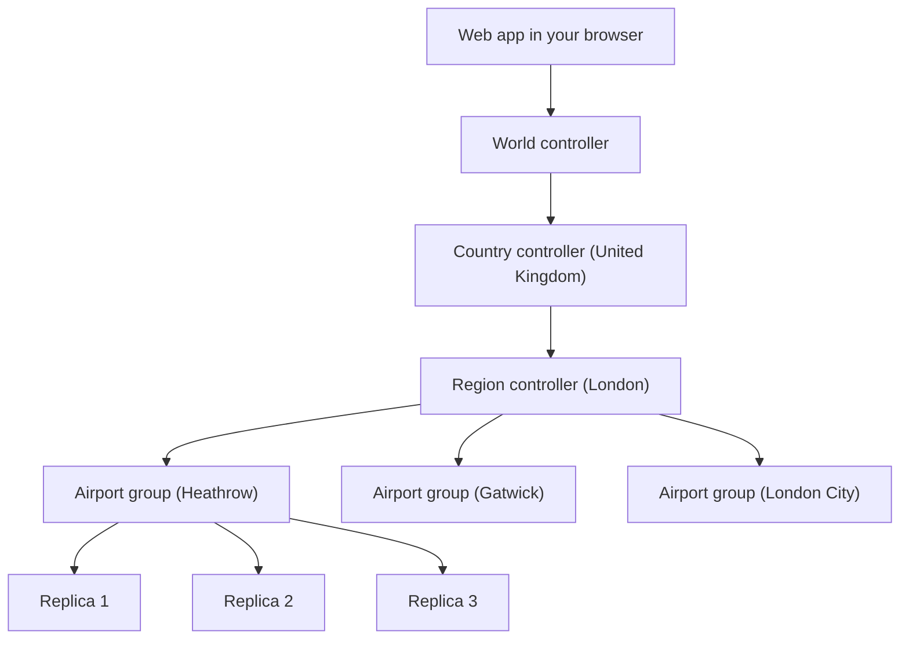
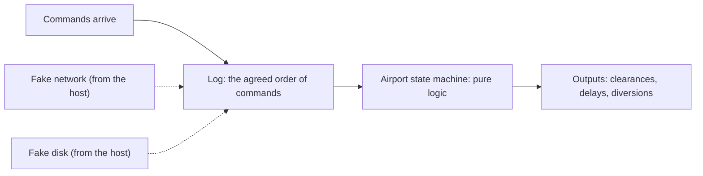

# Airport Simulator: Design Proposal

> [!summary] The proposal in five sentences
> The existing project is a calculator: it produces one number, the theoretical yearly capacity of an airport. This proposal starts a new project, Airport Simulator, in which individual aircraft land and depart, and in which storms, closures and groundings can be thrown at an airport at any moment. Each airport runs as three identical copies that must agree with each other, so that one copy can crash without anyone noticing. Airports are grouped into city regions and countries, with a controller at each level passing events downwards. All of it is written in Rust and runs inside one program on a simulated network, the way TigerBeetle tests its database, and that program runs inside a React web app so that you can watch it and press the "send a thunderstorm" button.

## 1. What this document is

This is a plan for how to build the simulator, in order, from a single airport up to several countries' worth of airports.

It is written so that each section can be read on its own. Where a section depends on an idea from earlier, the idea is restated briefly rather than assumed.

The plan is split into six phases, numbered 0 to 5. Every phase ends with something that runs and can be shown to another person. If the project stopped after any phase, what exists at that point would still be worth having.

The fixed decisions this plan is built on:

- **A new repository**, called Airport Simulator. The existing `AirportCapacityCalculator` repository is left alone and used only as a reference.
- **Rust** for everything that simulates.
- **React** for the web app, because the game-like, constantly animating screen needs it.
- **One repository with separate components inside it** (a "monorepo"), built with `just`, a small command runner that reads a `justfile`, rather than with Makefiles.
- **The agreement logic is written by hand**, not taken from a library. This is the logic that keeps the three copies of an airport identical.
- **The aviation is shallow but accurate.** Only a few aspects of real operations are modelled, but those few use real rules and real numbers. Phase 1 in section 6 lists them.
- **No containers and no Kubernetes.** Every copy of every airport runs inside a single program, and the network between them is simulated. Section 3 explains why. Section 12 describes what it would take to move to real machines later.

The detailed repository setup will be worked out in Claude Code. Section 9 gives only a sketch.

## 2. What exists already

The existing repository, `AirportCapacityCalculator`, is written in Go and works like this. A set of "policies" (curfew, maintenance, wind, gates, and so on) each write a list of timed events for the whole year in advance. The engine then walks through the year from one event to the next. For each stretch of time between two events, it works out which runways are usable and multiplies the length of that stretch by the rate at which each runway can handle aircraft. Adding those up gives the yearly total.

Three things about it matter for this proposal:

- **There are no aircraft.** The calculator reasons about rates, not about individual flights. Nothing ever queues, gets delayed or diverts.
- **Nothing can change mid-run.** Every event is known before the run starts. You cannot interrupt it with a storm.
- **Its ideas carry over, its code does not.** The airport and runway model, the logic that picks which runways can be used together in a given wind, and the time-ordered event queue are all rewritten in Rust for the new project. The calculator itself stays useful as a source of known-correct answers to check the new simulator against.

## 3. The idea in plain terms

The whole design uses nine words. They are defined here once, and each is re-explained in the section where it is first put to work.

| Word | Meaning |
|---|---|
| **Command** | One instruction or fact sent to an airport, such as "flight BA123 wants to land" or "runway 27L is closed". |
| **State machine** | The airport's rule book as a program. Given the current situation and one command, it produces the new situation. It does nothing else. |
| **Log** | The numbered list of every command an airport has received, in order. |
| **Replica** | One running copy of an airport's logic, with its own memory and its own log. |
| **Airport group** | Three replicas of the same airport. They keep identical logs, so they stay in identical states. |
| **Region** | Several airport groups that are close together, such as the airports around one city. |
| **Country** | Several regions. |
| **Controller** | A participant that sits above a set of airports, regions or countries and passes events down to them. |
| **Host** | The one real program. It runs every replica and every controller inside itself, and it plays the part of the network, the disks and the clock for all of them. |

The picture below shows how these stack up. The names are only examples. Everything in the picture below the web app lives inside the host.



### Why three copies of each airport

A simulator does not strictly need to survive crashes. The three copies are there because making several computers agree on one sequence of events is the central problem of distributed systems, and it is the thing this project exists to learn and to show off. It is also what makes the web app interesting: you can kill a replica and watch the other two carry on.

### What "like TigerBeetle" means here

TigerBeetle is a database whose team tests it in an unusual way. They run a whole cluster of database servers inside one ordinary program, with a fake network, fake disks and a fake clock. Because everything is fake, they can make the network drop messages or a disk corrupt data on purpose, run years of simulated time in hours, and replay any failure exactly by reusing the same random seed. They also compiled that program to run in a web browser as a game.

TigerBeetle does this for testing, and then ships the database to run on real machines. This proposal goes one step further and makes the fake-everything program the finished product. That program is the host from the table above.

### Why simulated, and not real containers

- **The interesting part is all still there.** The replicas really do have separate memory, really do exchange messages, and really do have to agree while messages are lost and replicas crash. The logic that solves that is identical whether the network is real or fake.
- **What is left out is operations work.** Container images, Kubernetes and network configuration are worth knowing, but they are a different skill, and they would take a large share of the effort while adding nothing to the simulation.
- **Failures become cheap and repeatable.** On real machines a rare failure may never be seen twice. In the host, any run can be replayed exactly from its seed.
- **It runs anywhere.** One program on a laptop, or one tab in a browser with no servers at all.

### A distributed systems project, not a concurrency project

These two are easy to mix up, so it is worth being exact about which one this is.

- **Concurrency** in the programming sense means threads, locks, and several pieces of code touching the same memory at the same instant.
- **Distributed systems** means several independent participants that share nothing, can only talk by sending messages, and must still agree while messages are lost and participants crash.

This project is purely the second. Each replica handles one thing at a time, from start to finish, and the host decides whose turn is next. There are no threads and no locks anywhere.

That is not a shortcut. The real TigerBeetle database works the same way: each of its servers is deliberately single-threaded, and the difficulty lies entirely in getting separate servers to agree. Which is why the same code can run on real machines and inside their browser game.

### Why Rust suits this

Rust compiles to WebAssembly, a format that browsers can run, and it does so with small, fast results and mature tooling. That changes the plan in a useful way: the host does not need to run as a server for the web app to talk to. The host runs inside the web page itself, from the first phase that has a web page. There is nothing to deploy.

## 4. Three rules the whole design rests on

Everything later in the document follows from these.

**Rule 1: The logic is deterministic.** "Deterministic" means that the same starting point and the same inputs always give exactly the same result, on any machine, every time. This is what allows three replicas to stay identical, and it is what allows a bug to be replayed.

**Rule 2: Everything from outside arrives as a command in the log, including time.** The airport logic never asks the computer what time it is. Instead, one kind of command says "the simulated time is now 14:03:20". This means the passage of time is recorded in the log like everything else, and simulated time can run faster or slower than real time just by sending those commands at a different pace.

**Rule 3: Anything that would touch the real world goes through the host.** A replica never opens a network connection, reads a file, reads the clock or rolls a random number by itself. It asks the host, through a small interface. The host answers with its fake versions. Keeping this boundary clean costs almost nothing, and it is the reason real versions could be swapped in one day without touching the logic.

### What these rules forbid in Rust

Rust has several features that quietly break Rule 1. Inside the host and everything it runs, the following are banned. Rust's standard code checker, Clippy, can be given a list of forbidden functions and types, so the ban is enforced automatically.

- **Reading the real clock** (`Instant::now`, `SystemTime::now`).
- **The standard hash map and hash set**, when looped over. Rust shuffles their order differently on every run. Ordered maps (`BTreeMap`) are used instead.
- **Threads and asynchronous runtimes** such as Tokio, because the order things run in is not predictable.
- **Unseeded random numbers.** One named, seeded generator is used everywhere, and it is pinned to a specific algorithm so that an update to a library cannot change the sequence.
- **Floating-point numbers.** Plain arithmetic is consistent, but functions such as sine and cosine are allowed to give slightly different answers on different platforms, and the wind calculation needs them. Times become whole milliseconds, wind becomes whole knots and whole degrees, and the sine needed for crosswind comes from a small fixed table.
- **Numbers whose size depends on the machine** (`usize`) inside saved state. A browser is a 32-bit environment and a laptop is 64-bit, and the two must agree exactly.

## 5. How the pieces fit together

This section describes one replica, and then the host that runs many of them.

### Inside one replica

A replica is one copy of an airport's logic. It has two parts.



- The **log** is where the three replicas of an airport group agree on the order of commands. Only once a majority (two of the three) have stored a command is it considered final.
- The **airport state machine** then applies each final command, one at a time, in order.
- The **outputs** are what the airport decides as a result: "BA123 is cleared to land on 27L at 14:05:10", or "BA123 cannot be accepted and must divert".

After applying each command, a replica computes a short fingerprint (a hash) of its entire state. If two replicas ever show different fingerprints at the same log position, Rule 1 has been broken somewhere and there is a bug. This single check catches a large class of mistakes, and it is also something the web app can display.

### Inside the host

The host is the one real program, and it runs everything else inside itself. At its centre is a single to-do list ordered by simulated time. Entries on the list are things like "deliver this message to Heathrow replica 2 at 14:03:20.150" or "wake Gatwick replica 1 because its timer has gone off".

The host works in a loop:

1. Take the earliest entry off the list.
2. Move the simulated clock to that entry's time.
3. Hand the entry to the replica or controller it is for.
4. That participant reacts, perhaps by asking to send some messages.
5. The host decides the fate of each message (deliver after a delay, deliver twice, or lose it) and adds the results to the list.

Every decision in step 5 comes from one random seed.

### A recording is just a seed and a list

Because of Rule 1, a complete run is fully determined by two small things: the seed, and the list of events a person injected along with the simulated time of each. Nothing else needs to be saved. To replay a run, the host is simply run again with the same two things, and it does exactly what it did before.

This matters in practice. When an overnight test finds a failure, it prints a seed. Pasting that seed into the web app shows the failure happening, step by step.

### Two ways to run the same host

The host is written once, as a Rust library, and wrapped twice:

- **As a command-line program**, for running huge numbers of seeds quickly and unattended.
- **As WebAssembly inside the web app**, for watching and interacting.

Both must behave identically for the same seed. That is checked by a test.

## 6. The build plan

Each phase below has the same five parts: the goal in one sentence, what gets built, why it comes at this point, how you know it is finished, and what you can show someone.

Rough size is given as small, medium or large. These are relative guesses, not estimates in hours.

### Phase 0: Set up the new repository (small)

**Goal.** An empty but fully wired project, where a line of Rust can be changed and seen in the browser.

**What gets built.**
- The new repository, laid out as separate components. Section 9 has the sketch.
- A `justfile` with the everyday commands: build, test, check, run the web app.
- The automated ban on the features listed in section 4.
- A trivial Rust function compiled to WebAssembly and called from a bare React page.
- Automatic checks that run on every commit.

**Why now.** The path from Rust to the browser has the most unfamiliar tooling in the project. Proving it works while there is nothing else to go wrong is much cheaper than discovering a problem in Phase 3.

**Done when.** One command builds everything, one command tests everything, and the React page shows a value computed in Rust.

### Phase 1: One airport, one copy (medium to large)

**Goal.** The airport's rule book on its own: individual aircraft, and the ability to be interrupted at any point. No replicas and no network yet.

**What gets built.** The airport state machine. It accepts commands and produces outputs. A first set of commands:

| Command | What it means |
|---|---|
| Advance time | "The simulated time is now X." |
| Request landing | A flight of a given aircraft type wants to land, no earlier than a given time. |
| Request departure | A flight of a given aircraft type wants to take off, no earlier than a given time. |
| Declare emergency | A flight has declared an emergency, either urgent ("pan-pan") or life-threatening ("mayday"). |
| Close runway | A runway is unusable until further notice, with a reason (maintenance, storm). |
| Open runway | A runway is usable again. |
| Set wind | The wind is now a given speed and direction. |
| Ground stop | No movements at all until lifted. |

Inside, the airport keeps a queue of waiting flights and hands out runway slots first come, first served, subject to the separation rules below. The logic that chooses which runways can operate together in the current wind is rewritten from the old calculator.

**What "shallow but accurate" means.** Four aspects of real operations are modelled, using real rules and published numbers. Everything else about aviation is left out.

1. **Landing separation.** Every aircraft leaves turbulent air behind it, called wake, and heavier aircraft leave more. Aircraft are sorted into the standard international weight classes (light, medium, heavy, and super for the Airbus A380), and the required gap behind an aircraft depends on both its class and the class of the one following. For example, a light aircraft must stay 6 nautical miles behind a heavy one, while a heavy behind a heavy needs 4. Where wake is not the limit, a general minimum of 3 nautical miles applies. Departures use time gaps instead, such as 2 minutes behind a heavy.
2. **Flight performance.** Each aircraft type has a final approach speed. This is what turns a gap in miles into a gap in seconds: 5 nautical miles at 140 knots is about 129 seconds. So a slow aircraft following a fast one opens the gap up, and the order of the queue changes how many aircraft get through. Performance is kept to a short table per aircraft type: weight class, approach speed, and the runway length it needs.
3. **Runway exit time.** A runway holds one aircraft at a time. After touching down, an aircraft occupies the runway until it has turned off, typically a little under a minute, and the next arrival may not cross the start of the runway until it has. The time depends on the aircraft type and on where the runway's exits are.
4. **Emergencies.** A flight that declares an emergency jumps the queue. Other arrivals are held or sent around to make room. After a mayday landing the runway stays closed for a period while it is inspected, which is where the knock-on delays come from.

The required gap between two aircraft is whichever of these rules demands the most. All numbers live in data tables, not in code, and are to be checked against the international rule book (ICAO Document 4444) when they are entered.

Two helpers are built alongside:
- A **traffic generator** that produces a stream of flight requests from a random seed.
- A **command-line runner** that feeds a list of commands into the airport and prints the result.

The old calculator's policies (curfew, maintenance schedule, wind schedule) reappear as small generators of commands.

**Why now.** Everything else in the project is machinery for running this piece reliably. It needs to exist and be correct first.

**Done when.**
- Running the same commands twice gives the same state fingerprint, both as a normal program and as WebAssembly in the browser.
- When the airport is flooded with more flights than it can handle for a simulated year, the number it gets through matches the answer from the old Go calculator, for the constraints both models share (curfew, maintenance, wind and runway layout). For this comparison the simulator is set up the way the calculator sees the world: one aircraft type and one fixed gap per runway. The old calculator is run once per scenario and its answers are saved as expected values.

**What you can show.** A web page that runs one airport and draws a timeline for each runway, with every landing and take-off as a mark, and gaps where a runway was closed.

### Phase 2: The host, and three replicas that agree (large)

**Goal.** Three copies of the airport that agree on the order of commands and survive failures, all running inside the host.

This is the hardest phase and the core of the project.

**What gets built.**
- **The host.** The single program described in section 5, with its time-ordered to-do list, its fake network, its fake disks and its seed.
- **Faults.** The fake network can delay, drop, duplicate and reorder messages, and can cut a replica off from the others. The host can also crash a replica, which wipes its memory but leaves its fake disk, and restart it later.
- **The agreement logic.** This is what makes three replicas keep identical logs. The proposal is to write an implementation of Raft, a well-documented agreement method designed to be understandable. In Raft one replica is the leader and the others are followers. Commands go to the leader, the leader copies them to the followers, and if the leader disappears the others elect a new one.
- **The checkers.** Rules that must hold at every step of every run. They are listed in section 8.

**Why now.** With the airport's rule book trusted from Phase 1, any bug found here must be in the new agreement logic. That keeps debugging narrow.

**Done when.** The command-line program runs a very large number of random seeds overnight with faults switched on and no checker ever fails. Any failure found along the way can be replayed exactly from its seed.

**What you can show.** The web page gains a replica view: three boxes with messages moving between them, the current leader highlighted, and each replica's log position and state fingerprint shown. Typing in a seed plays that run, including one where the leader is crashed and a new one takes over.

### Phase 3: A controller and the interactive web app (medium)

**Goal.** A web app that lets you interfere with a running airport group, not only watch it.

**What gets built.**
- **The controller.** A new kind of participant inside the host, sitting above the airport group. Events from the outside world go to the controller. It finds the group's current leader and passes the events on as commands. It also sends the "the time is now X" commands that Rule 2 requires.
- **A speed dial.** Pause, real time, or many times faster. This only changes how quickly the host works through its to-do list. It does not change the outcome.
- **Buttons for the airport.** Send a thunderstorm, close a runway, change the wind, declare a ground stop.
- **Buttons for the machinery.** Crash a replica, restart it, cut it off from the others, make the network slow or lossy.
- **Saving and loading a session.** As section 5 explained, a session is only a seed and the list of buttons pressed with their simulated times, so this is a small file.
- **A background thread in the browser.** The host is moved off the part of the browser that draws the screen (into what browsers call a Web Worker), so that running at high speed never freezes the page.

**Why now.** One airport is the smallest setting in which the web app is satisfying, and building the controller for one airport first means its job is well understood before there are many.

**Done when.** From the browser alone, you can start traffic, throw a storm at the airport, watch the queue build and drain, crash the leader and watch a new one take over. Loading the saved session gives the same result.

**What you can show.** This is the first version worth showing to someone who is not a programmer. Because the whole thing is a web page with no server behind it, it can be published as a plain website.

### Phase 4: Several airports in a region (medium to large)

**Goal.** Multiple airport groups near one another, with flights travelling between them and diverting when something goes wrong.

**What gets built.**
- **More airport groups in the host.** The host from Phase 2 already runs any number of participants, so this is mostly configuration.
- **A region controller.** It sits above the airport groups in one area, as in the picture in section 3.
- **Flights with an origin and a destination.** When a flight departs one airport, that airport outputs "departed, heading for X, expected at time T". The region controller delivers this to airport X as an inbound flight.
- **Diversions.** When an airport cannot accept a flight (storm, closure, ground stop), it says so, and the region controller chooses another airport in the region.
- **Delay on news.** News of a closure or diversion takes a while to travel, in simulated time. This models the real lag between something happening and a flight plan being updated, which the voice note asked for. It needs no new machinery, because the host's fake network already delivers every message after a delay.
- **Region-wide events.** A storm has a position and a size. The region controller works out which airports are underneath it and sends each of them the appropriate command.

**Keeping time in step.** Each airport group has its own log, so its sense of the time can run slightly ahead of or behind its neighbours. The rule is simple: an airport never goes back in time. If a message arrives stamped earlier than the airport's current time, it takes effect now. Because the host fixes the order in which everything happens, this is still exactly repeatable.

**Making delivery reliable.** A message between groups may be sent more than once, for example when a leader changes halfway through sending. Each message carries a number, and the receiving airport ignores any number it has already seen.

**Done when.** With three airports running, closing one causes its inbound flights to land at the other two, and replaying the same session produces the same outcome for every flight.

**What you can show.** The web app gains a map view of the region: airports as points, flights moving between them, a storm you can drag over an airport, and flights visibly turning away. Clicking an airport opens the single-airport view from Phase 3.

### Phase 5: Countries, and beyond (open-ended)

**Goal.** Stack the same building blocks higher, and polish.

**What gets built.** Roughly in order of value:
1. **Country controllers and a world controller.** Each does for the level below what the region controller does for airports: it passes events down and routes flights between its children.
2. **Replicated controllers.** Until now each controller is a single participant, and if it is crashed, its part of the world stalls. A controller can itself be written as a state machine with a log and run as three replicas, reusing all of the agreement logic from Phase 2.
3. **Disk faults.** Teaching the fake disks to corrupt or lose data, and the replicas to notice and repair it from each other.
4. **Scenarios.** Saved sessions with a name, such as "storm over the capital during the evening peak", that can be loaded and replayed.
5. **Fault levels.** Preset difficulty settings in the spirit of the TigerBeetle demo, from "perfect network" up to "everything is on fire".

**Done when.** This phase has no single finish line. Each item is its own small project.

## 7. The web app as a whole

The web app is built up phase by phase, as described above. Gathered in one place, it has three levels of zoom:

| Level | What you see | Arrives in |
|---|---|---|
| **Runway** | A timeline per runway: each landing and take-off, closures, the waiting queue. | Phase 1 |
| **Replicas** | The three copies of one airport, messages between them, who is leader, log positions, state fingerprints. | Phase 2 |
| **Map** | Airports, flights in the air, weather, diversions. | Phase 4 |

The web app does no simulating of its own. The Rust host, compiled to WebAssembly, runs inside the page, and the React code asks it for three things only: take some steps, accept an event from a person, and describe the current state of everything. React draws what it is told.

React handles the panels, buttons and controls. The constantly moving parts (aircraft, messages between replicas) are drawn on a canvas, which is the browser's surface for fast free-form drawing, because redrawing hundreds of moving items through ordinary page elements would be slow.

## 8. How it is tested

Testing is the heart of the "like TigerBeetle" idea. There are five layers, from fastest to slowest.

1. **Ordinary unit tests** of the airport state machine. Because it is pure logic with no network or clock, these are simple: given this state and this command, expect that state.
2. **Random-input testing** of the airport state machine. A tool invents command sequences and looks for crashes or broken rules, then shrinks any failure down to the shortest sequence that still fails.
3. **Seeded runs of the host** with faults switched on, in bulk. Each seed is a different history of delays, losses and crashes. This is where most of the confidence comes from.
4. **Run-it-twice tests.** The same seed is run twice, and once more as WebAssembly, and the runs are compared step by step. Any difference means something non-deterministic has crept in.

The checkers used in layers 2 and 3 are rules that must never be broken:

- **Agreement.** Two replicas never hold different commands at the same position in their logs, and never show different state fingerprints at the same position.
- **Separation.** Two aircraft never use the same runway closer together than the rules require for that pair of aircraft types.
- **One at a time.** A runway never has two aircraft on it at once.
- **Emergencies first.** No ordinary flight is given a slot ahead of a declared emergency that could have used it.
- **Closures respected.** Nothing moves on a closed runway, during a curfew or during a ground stop.
- **Layout respected.** Runways that cross each other are never in use at the same time.
- **No lost flights.** Every flight that was accepted eventually lands, departs, diverts or is cancelled, once any faults have cleared.
- **No duplicated flights.** A flight is never in two places at once.

## 9. Technology and repository layout

| Area | Choice | Reason |
|---|---|---|
| Simulation language | Rust | Decided. Strong fit for deterministic logic and for WebAssembly. |
| Where it runs | One program, the host | See "Why simulated" in section 3. |
| Agreement method | Raft, written by hand | Decided. The best-documented method, and writing it is the main learning goal. |
| Reference for agreement | The `raft` library from the TiKV project | Not used in the project. It is written as pure logic with no clock or network of its own, which is the same shape as ours, so it is a good thing to read when stuck. |
| Web app | React with TypeScript, canvas for the animated parts | Decided. See section 7. |
| Rust to browser | WebAssembly, with the standard Rust binding tools | Lets the host run in the page with no server. |
| Data between Rust and React | JSON to begin with | Readable while debugging. Can be swapped for something compact later. |
| Build commands | `just` and a `justfile` | Decided. |

A sketch of the repository. The names and the exact split are to be settled in Claude Code.

```
airport-simulator/
├── justfile        everyday commands for the whole repository
├── crates/         the Rust components
│   ├── airport/    the airport state machine (Phase 1)
│   ├── raft/       the agreement logic (Phase 2)
│   ├── host/       fake network, disks, clock, faults, checkers (Phase 2)
│   ├── cli/        command-line program for bulk seeded runs
│   └── wasm/       thin wrapper that exposes the host to the browser
├── web/            the React web app
└── docs/           this proposal and later design notes
```

The point of the split is that each component depends only on the ones above it in the list, and the `airport` component knows nothing about replicas, networks or browsers.

## 10. Risks

| Risk | Why it matters | What we do about it |
|---|---|---|
| Agreement logic is subtly wrong | It is famously easy to get wrong, in ways that appear once in a million runs. | Bulk seeded runs with the checkers on, and exact replay of any failure from its seed. |
| Something non-deterministic slips in | Replicas drift apart and replay stops working. | The automated ban from section 4, the fingerprint comparison, and the run-it-twice tests. |
| The browser and the laptop disagree | A seed that fails overnight would not fail when replayed in the web app. | The run-it-twice test includes a WebAssembly run from Phase 1 onwards. |
| Rust slows early progress | The host owns many participants that all change state, which is the kind of structure Rust is strictest about. | Phase 0 and Phase 1 are deliberately small. The host passes messages between participants rather than letting them hold references to each other, which sidesteps most of the difficulty. |
| "It is not really distributed" | Nothing ever crosses a real network. | True, and accepted. The agreement logic is the real thing. Rule 3 keeps the door open, as section 12 describes. |
| The aviation model swallows the project | Real air traffic control is bottomlessly detailed, and asking for accuracy invites more of it. | Accuracy is limited to the four aspects listed in Phase 1. Anything else needs a deliberate decision to add. |
| The project is too big to finish | Six phases is a lot for spare time. | Every phase ends in something that runs and can be shown. |

## 11. Deliberately out of scope

These are left out so that the distributed-systems work stays the focus.

- Real networks, containers and Kubernetes. Section 12 covers how they could be added.
- A server behind the web app. The host runs in the page.
- Realistic airspace: routes, holding patterns, altitude, separation in the air.
- Reduced separations that depend on weather, special procedures or newer regional schemes. The standard international minimums are used throughout.
- Aircraft performance beyond the short table in Phase 1: no climb rates, fuel burn or weight changes.
- Airline behaviour, passengers, crews, fuel.
- Real-world flight data. Traffic is generated, not imported.
- More than three replicas per airport, or changing the number while running.

## 13. Decisions

Nothing is currently open. For the record, these were settled while the plan was being written:

| Question | Answer |
|---|---|
| Which language? | Rust, in a new repository. React for the web app. |
| Real containers or a simulated network? | Simulated network, everything in one program. |
| Write the agreement logic or use a library? | Write it by hand. |
| How deep should the aviation go? | Shallow but accurate: the four aspects listed in Phase 1. |
| Is this a concurrency project? | No. It is a distributed systems project, as section 3 explains. |

## Sources

- [AirportCapacityCalculator repository (the existing Go calculator)](https://github.com/harrydayexe/AirportCapacityCalculator)
- [We Put a Distributed Database In the Browser (TigerBeetle)](https://tigerbeetle.com/blog/2023-07-11-we-put-a-distributed-database-in-the-browser/)
- [The Raft consensus algorithm](https://raft.github.io/)
- [tikv/raft-rs, a Raft library in Rust](https://github.com/tikv/raft-rs)
- [MIT distributed systems course, which teaches Raft (its exercises are in Go)](https://pdos.csail.mit.edu/6.824/)
